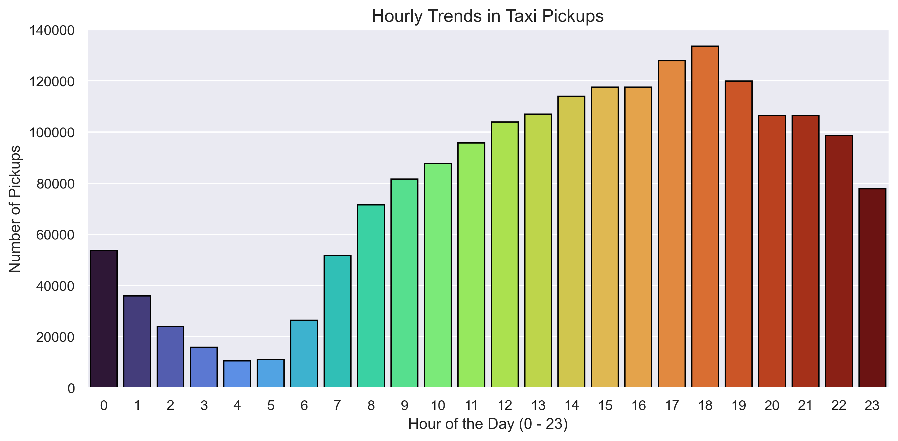
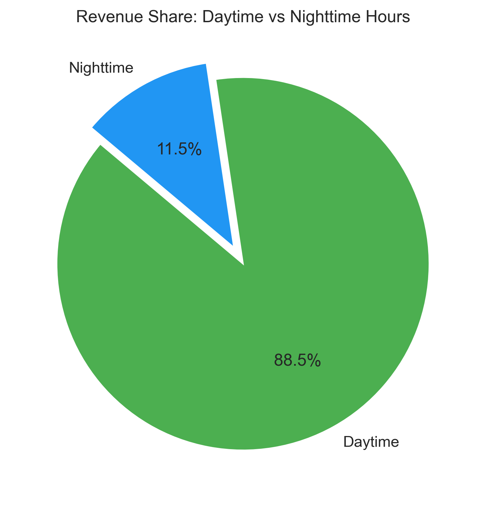
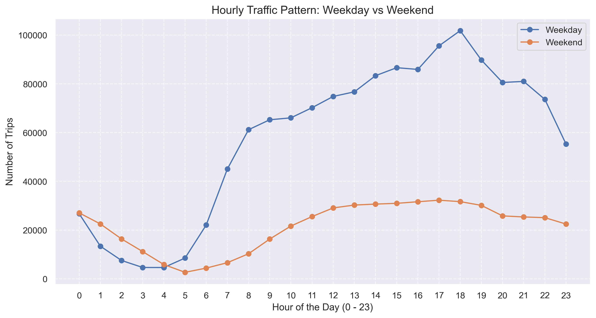
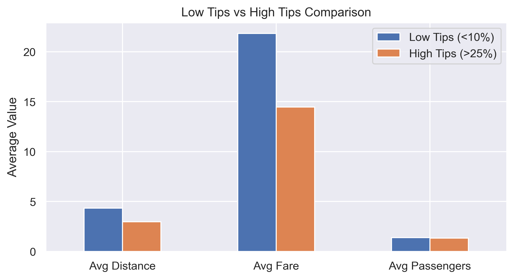

# 🚕 NYC Yellow Taxi – EDA Project using Python


---

## 📌 Overview

Exploratory Data Analysis (EDA) on real-world **NYC Yellow Taxi trip data for 2023**, done as a guided data-analytics case study.
The goal: find demand, revenue, pricing and tipping patterns that could help a taxi operator place cabs better and price trips smarter.

---

## 📊 Dataset

| Detail | Info |
|--------|------|
| Source | [NYC Taxi & Limousine Commission (TLC) Trip Record Data](https://www.nyc.gov/site/tlc/about/tlc-trip-record-data.page) |
| Period | January – December 2023 |
| Sample used | 5% sample, **1,896,427 rows × 20 columns** (Parquet) |
| Key columns | pickup/dropoff time, pickup/dropoff zone, trip_distance, fare_amount, tip_amount, total_amount, payment_type, passenger_count, VendorID |

The dataset is not included in this repo because of its size. Download the 2023 Yellow Taxi files from the TLC link above.

---

## 🧹 Data Cleaning Steps

1. Dropped unneeded columns (`store_and_fwd_flag`) and merged the two duplicate airport fee columns (`Airport_fee`, `airport_fee`) into one.
2. Checked for negative fares (none found in the sample).
3. Missing values: `passenger_count` and `RatecodeID` were each missing in **3.4%** of rows. Filled `passenger_count` with the median, and `RatecodeID` and `congestion_surcharge` with 0.
4. Removed trips with more than 6 passengers (very rare).
5. Excluded zero-distance trips from fare-per-mile and revenue analysis.
6. Created new columns: pickup hour, day of week, month, weekend flag, trip duration, fare per mile, tip %.

---

## 🔍 Key Insights

1. **Peak demand is in the evening.** Pickups rise steadily through the day and peak at **6 PM (~134K trips in the sample)**. The quietest hours are **4–5 AM** (~11K trips).
2. **Night is a small slice of revenue.** Trips between 11 PM and 5 AM bring only **11.5%** of revenue; daytime brings **88.5%**.
3. **Revenue is spread evenly across the year.** Q4 (26.9%) and Q2 (26.8%) were slightly stronger than Q1 (23.6%) and Q3 (22.7%).
4. **Shared rides are much cheaper per person.** Average fare per mile per passenger falls from **$10.70** for solo riders to **$1.57** for 6 passengers.
5. **Shorter, cheaper trips get better tips (as a % of fare).** Trips with tips above 25% averaged **2.98 miles / $14.46 fare**. Trips with tips below 10% averaged **4.34 miles / $21.84 fare**.

### 💡 Recommendations

- Put more cabs near business districts and airports during **8–10 AM and 5–8 PM**.
- Use a mild rush-hour surcharge (+10–15%) on busy routes, and small off-peak offers to keep drivers active in slow hours.
- At night, move idle cabs towards the few zones that still have high late-night pickups.

---

## 📈 Visualizations

**Hourly trends in taxi pickups**


**Revenue share: daytime vs night (11 PM – 5 AM)**


**Weekdays vs weekends – hourly traffic**


**Low tips vs high tips**


All other charts are in the [`images/`](images) folder.

---

## 🛠️ Tools Used

Python · Pandas · NumPy · Matplotlib · Seaborn · Jupyter Notebook

---

## 📁 Project Structure

```
├── NYC_Yellow_Taxi_EDA.ipynb   # Main analysis notebook
├── images/                     # All charts from the analysis
├── LICENSE
└── README.md
```

---

## ▶️ How to Run

```bash
git clone https://github.com/parastomar610-pixel/EDA-Project-using-Python-NYC-Yellow-Taxi-Real-World-Data.git
cd EDA-Project-using-Python-NYC-Yellow-Taxi-Real-World-Data
pip install pandas numpy matplotlib seaborn pyarrow jupyter
jupyter notebook NYC_Yellow_Taxi_EDA.ipynb
```

Change the file path in the data-loading cell to where you saved the Parquet file.

---

## 👤 Author

**Paras Tomar** – MIS Executive | Data Analyst
🔗 [LinkedIn](https://www.linkedin.com/in/paras-tomar-165364186/) · 📧 parastomar610@gmail.com
